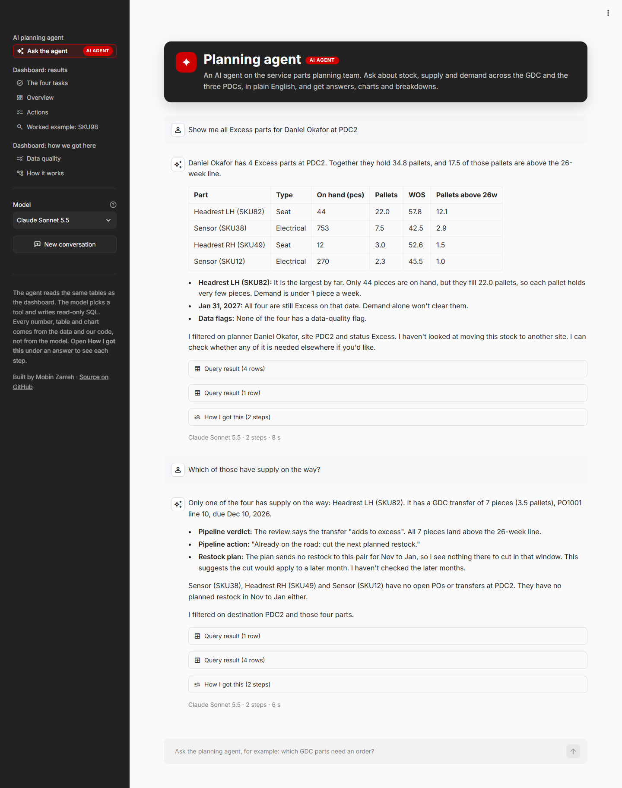
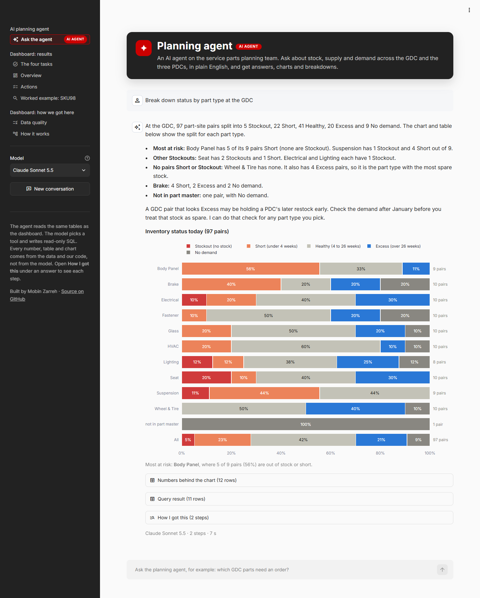
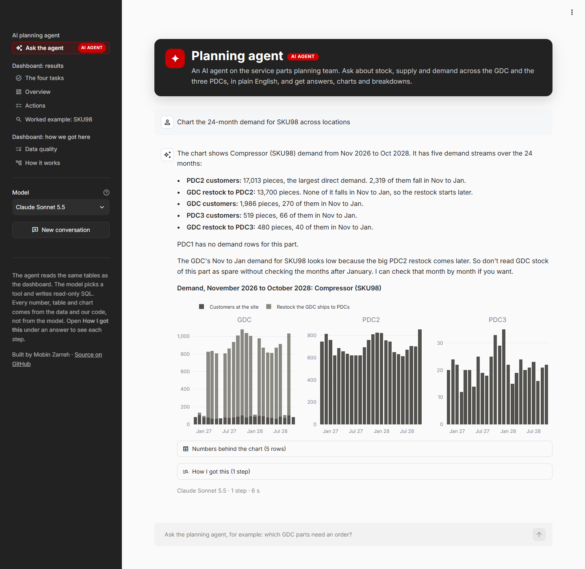
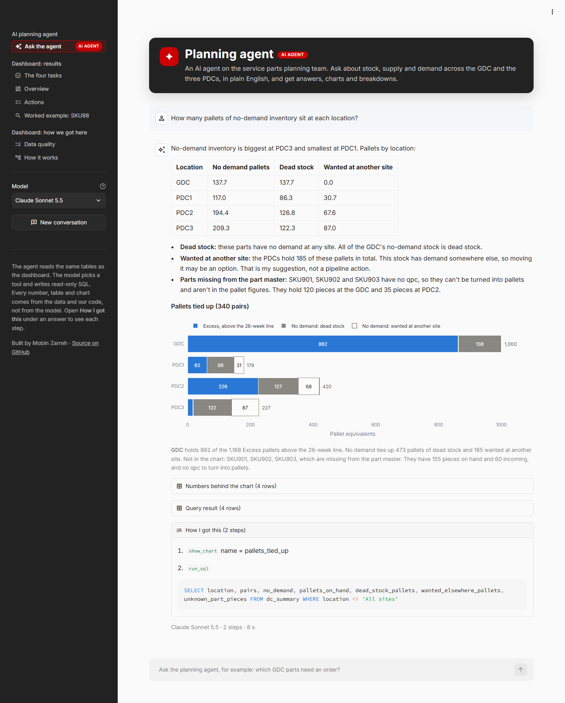
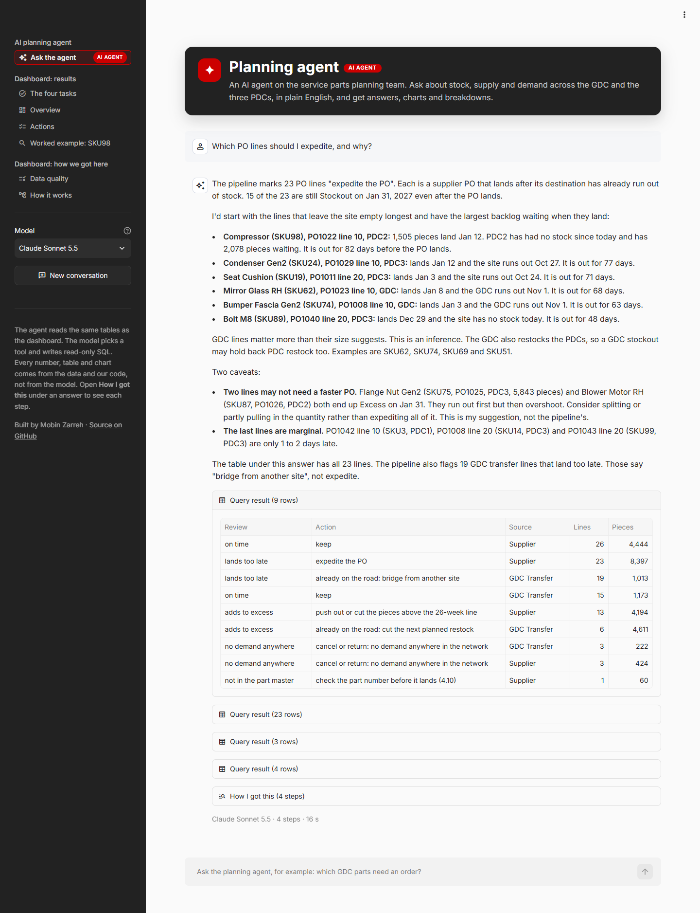
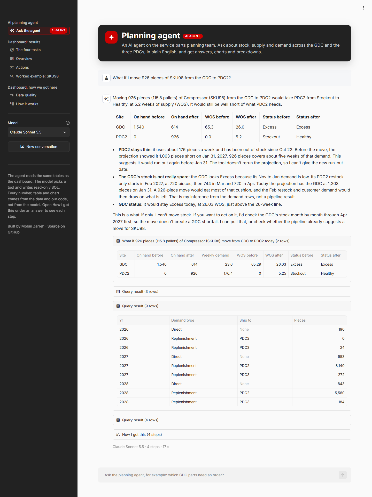
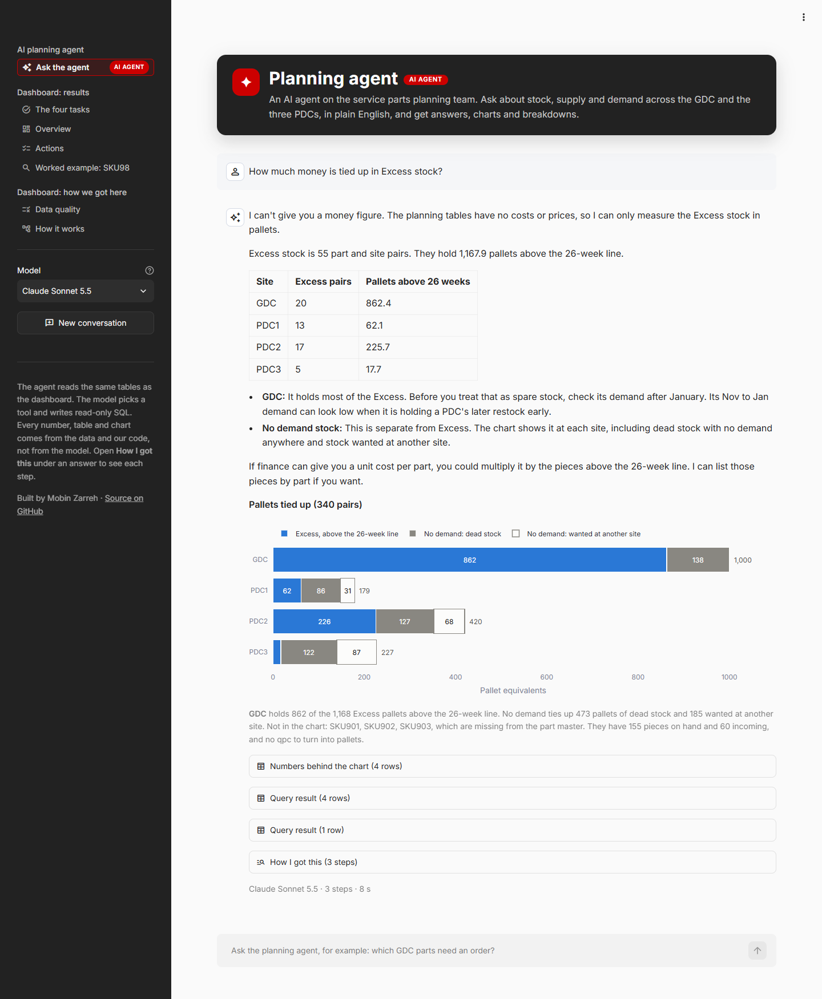

# Planning agent: demo

Seven questions to the planning agent: Tesla's four examples, then three more. The screenshots come from the app on Oct 30, 2026, with the default model (Claude Sonnet 5.5). I checked every number in every answer against the files in `output/`.

The app is also live, so you can ask your own questions: https://inventory-planning-case-study-a3gaqkykrzjhyq5mqi875s.streamlit.app/ (it takes a minute to wake up if nobody has opened it for a while). The wording changes a little from run to run, but the numbers come from the tables. Under each answer, **How I got this** shows every tool call and its SQL.

1. [Excess parts for a planner, and a follow-up](#1-show-me-all-excess-parts-for-daniel-okafor-at-pdc2)
2. [Status by part type at the GDC](#2-break-down-status-by-part-type-at-the-gdc)
3. [24-month demand for one part](#3-chart-the-24-month-demand-for-sku98-across-locations)
4. [No-demand pallets per site](#4-how-many-pallets-of-no-demand-inventory-sit-at-each-location)
5. [PO lines to expedite](#5-which-po-lines-should-i-expedite-and-why)
6. [A what-if stock move](#6-what-if-i-move-926-pieces-of-sku98-from-the-gdc-to-pdc2)
7. [A question the data can't answer](#7-how-much-money-is-tied-up-in-excess-stock)

## Tesla's four examples

### 1. "Show me all Excess parts for Daniel Okafor at PDC2"

One SQL query finds the four pairs. The follow-up, "Which of those have supply on the way?", uses the conversation's memory: it checks only those four parts, and quotes the pipeline's verdict and action for the one transfer on the road.

### 2. "Break down status by part type at the GDC"

The dashboard's own status chart, filtered to the GDC and grouped by part type. The sentence under the chart is written by the code, not the model.

### 3. "Chart the 24-month demand for SKU98 across locations"

Customer demand and the restock the GDC ships, per site. The answer points out that the GDC's big restock to PDC2 only starts after January, so the GDC's stock of this part is not spare.

### 4. "How many pallets of no-demand inventory sit at each location?"

**How I got this** is open: one query on `dc_summary` and the dashboard's pallets chart. The three parts missing from the part master have no pallet size, so they are reported in pieces.

## Three more

### 5. "Which PO lines should I expedite, and why?"

Task 4 as a question. It ranks the 23 lines the pipeline marks "expedite the PO" and labels its own suggestions as suggestions, not pipeline actions.

### 6. "What if I move 926 pieces of SKU98 from the GDC to PDC2?"

The what-if tool: on hand, weeks of supply and status at both sites, before and after. It shows today only and says that the projection to Jan 31 is not rerun.

### 7. "How much money is tied up in Excess stock?"

The data has no costs, so it says so and answers in pallets instead of inventing a number.

