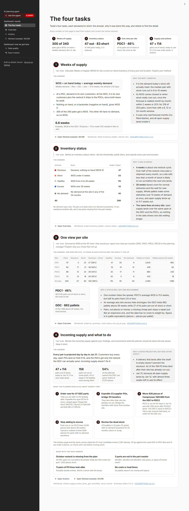
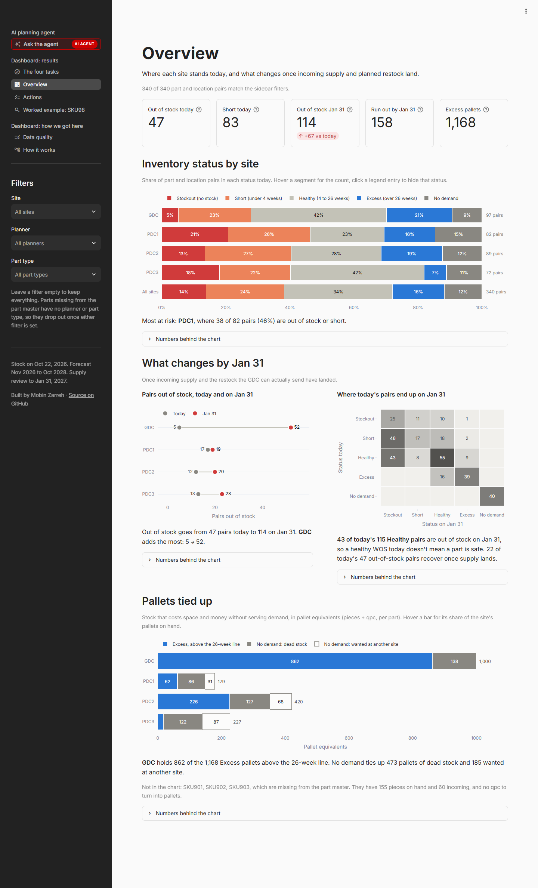
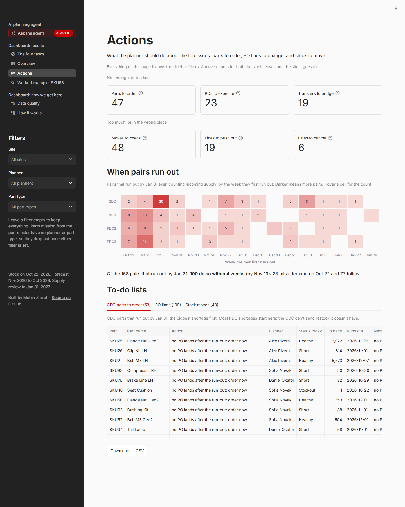
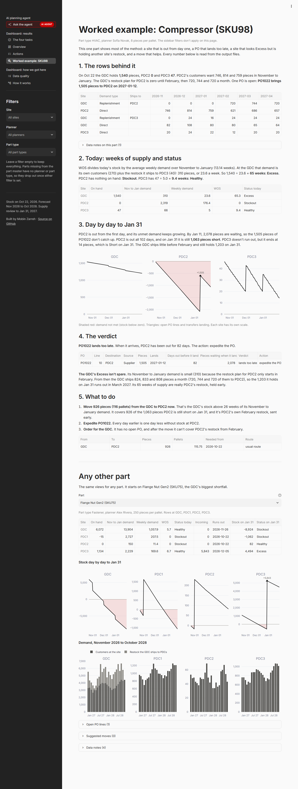
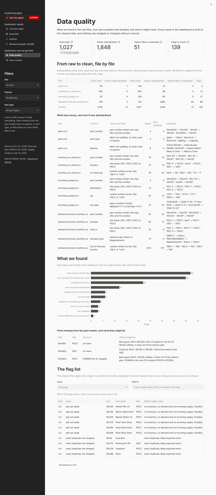
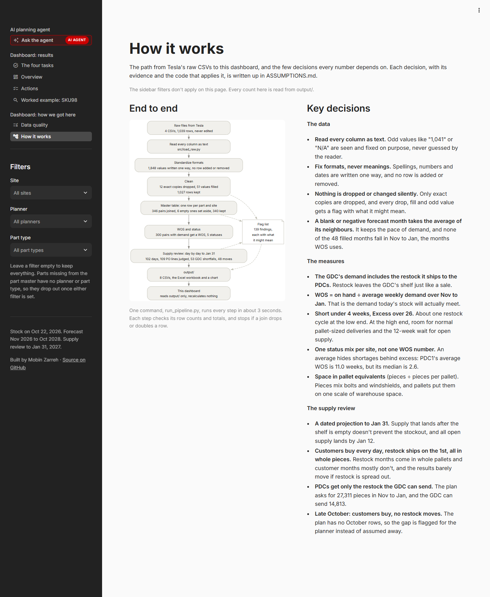

# Dashboard: screenshots

The dashboard is in the same app as the planning agent: https://inventory-planning-case-study-a3gaqkykrzjhyq5mqi875s.streamlit.app/ (it takes a minute to wake up if nobody has opened it for a while). It only reads the tables in `output/` and recalculates nothing, so every number matches the workbook. The sidebar filters by site, planner and part type. The screenshots show each page in full, with no filters set.

1. [The four tasks](#1-the-four-tasks)
2. [Overview](#2-overview)
3. [Actions](#3-actions)
4. [Worked example: SKU98](#4-worked-example-sku98)
5. [Data quality](#5-data-quality)
6. [How it works](#6-how-it-works)

## 1. The four tasks

Each of Tesla's four tasks answered in short: the answer, why it was done this way, and where to find the detail. Task 4 holds the ranked recommendations and the questions for the data owners.

## 2. Overview

Headline numbers, the status mix by site, what changes by Jan 31, and the pallets tied up in excess and no-demand stock.

## 3. Actions

GDC parts to order, PO lines by verdict and the candidate stock moves, each with a download button, plus when pairs run out.

## 4. Worked example: SKU98

One part followed from the raw rows to the suggested move, then the same views for any part.

## 5. Data quality

What was found in the raw files, how each problem was handled, and the full flag list.

## 6. How it works

The end-to-end flow with the counts at each step, and the key decisions behind the numbers.

